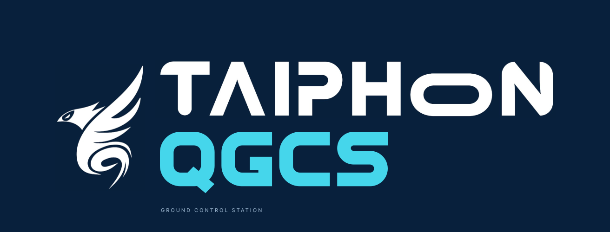
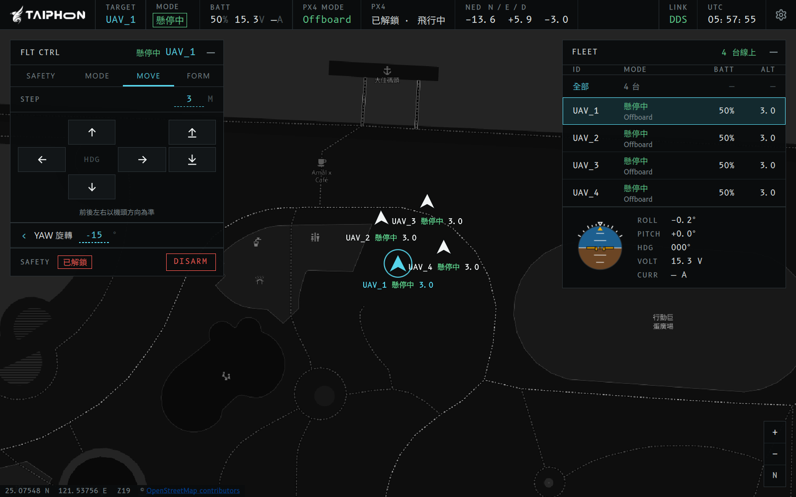
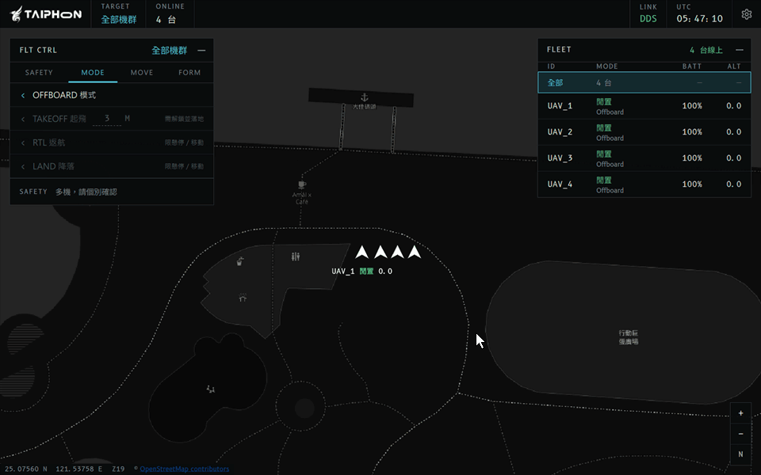
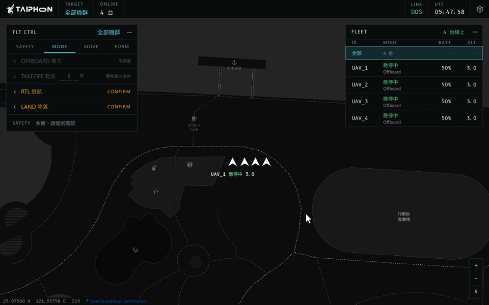
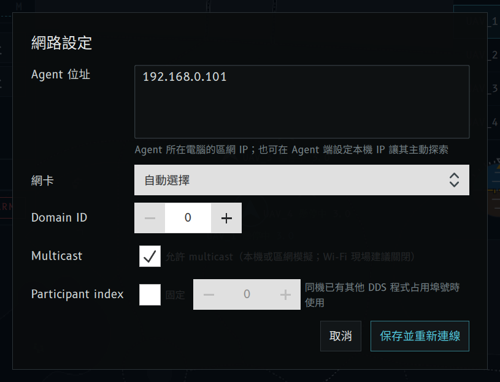
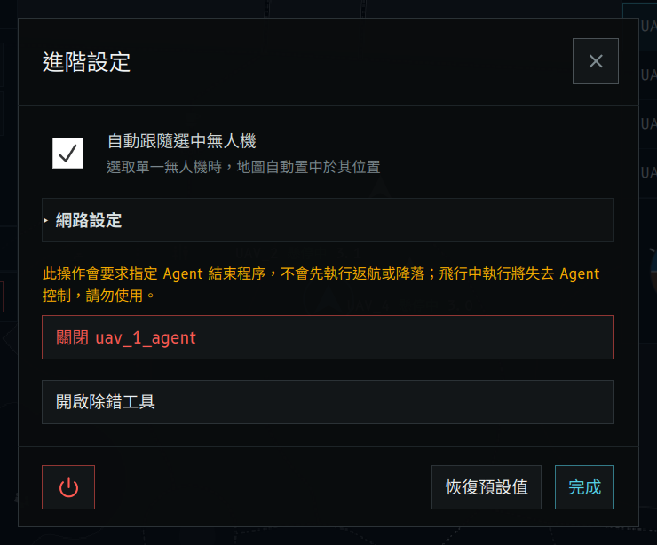
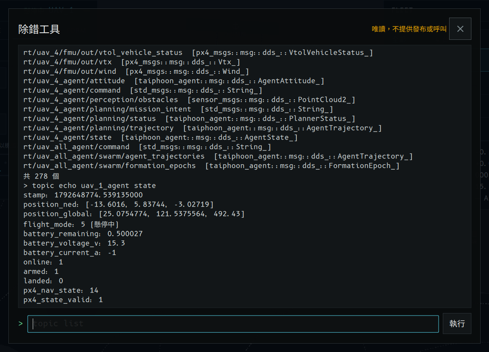
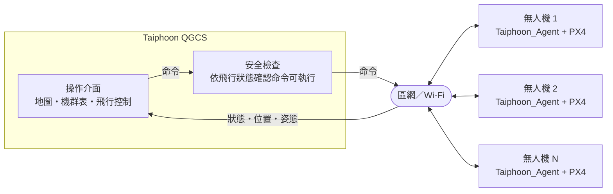

<p align="center">
  
</p>

<p align="center">
  <a href="https://github.com/Rex-Taiphoon/Taiphoon_QGCS/releases/latest"></a>
  <a href="#下載"></a>
  <a href="https://github.com/Rex-Taiphoon/Taiphoon_Agent"></a>
  <a href="#授權"></a>
</p>

**Taiphoon QGCS** 是以 Qt 框架開發的地面站，與 Taiphoon_Agent 搭配組成機群控制系統。下載後即可執行，不需安裝 Docker 或 ROS2；在地圖上掌握每台無人機的位置與狀態，並對單機或整個機群下達起飛、移動、編隊與降落命令。

<p align="center">
  
</p>

## 特色

- **下載即用**：安裝或解壓縮後直接執行，不需安裝 Docker、ROS2，也不必另外設定通訊環境。
- **機群自動上線**：Agent 啟動後自動出現在機群表，不需事先登錄機號或數量。
- **全機群一鍵操作**：選取「全部機群」即可同時解鎖、起飛、返航、降落，或下達環形、水平一字、燕行編隊。
- **防誤觸設計**：命令會依目前飛行狀態檢查是否可執行；解鎖需滑動，起飛、返航、降落與編隊需再按 EXEC 確認。
- **一眼掌握狀態**：航電座艙風格的深色介面，狀態列、機群表與姿態儀即時顯示模式、電量與高度；按鈕顏色代表風險等級。
- **跨平台**：支援 Windows 與 macOS。
- **唯讀除錯工具**：查看各 Agent 的即時資料與事件紀錄，協助排查連線問題，不會對無人機送出任何指令。

## 實際操作

### 解鎖與起飛

<p align="center">
  
</p>

選取「全部機群」，滑動解鎖 ARM 後按 TAKEOFF，再按 EXEC 確認，4 台無人機同時起飛到 3 公尺懸停。

### 編隊飛行

<p align="center">
  
</p>

在 FORM 分頁選擇環形編隊、將半徑改為 15 公尺後按 CONFIRM 與 EXEC，接著切換為燕行編隊（V 字，頂點朝北）。各機的位置分配與避碰由 Agent 自動處理；畫面下方的倍速標示為剪輯時加速的段落。

### 更多畫面

| 網路設定 | 進階設定 | 唯讀除錯工具 |
|:---:|:---:|:---:|
|  |  |  |

> 以上畫面取自 4 台模擬無人機（PX4 SITL）；地圖資料 © OpenStreetMap contributors。

## 下載

選擇你的平台下載最新的穩定版本，或到 [Releases 頁面](https://github.com/Rex-Taiphoon/Taiphoon_QGCS/releases/latest)查看所有檔案：

<p align="center">
  <a href="https://github.com/Rex-Taiphoon/Taiphoon_QGCS/releases/latest"></a>
  <a href="https://github.com/Rex-Taiphoon/Taiphoon_QGCS/releases/latest"></a>
</p>

- **Windows 10／11 x64**：安裝程式（`.exe`）會自動建立防火牆規則；也可下載免安裝版（`.zip`）。
- **macOS 12 以上（Apple Silicon／Intel）**：磁碟映像檔（`.dmg`），同一個檔案支援兩種晶片。

<details>
<summary>安裝注意事項</summary>

- **Windows**：偵測到舊版時，安裝程式會詢問後先移除舊版再安裝，原本的設定會保留。
- **macOS**：下載後會被 Gatekeeper 阻擋。開啟一次後，到「系統設定 → 隱私權與安全性」按「強制打開」。

</details>

## 快速開始

1. Windows 執行安裝程式，或解壓縮 ZIP 後開啟 `bin/Taiphoon_QGCS.exe`；macOS 開啟 DMG 後安裝 Taiphoon_QGCS。
2. 首次啟動會出現「網路設定」：填入 Agent 所在電腦的區網 IP（多台以換行分隔）。同一台電腦或允許 multicast 的區網可留空。之後可在「進階設定 → 網路設定」修改，保存後立即重新連線。
3. Windows 首次執行詢問防火牆時請允許，否則收不到 Agent 資料。安裝程式會自動建立規則（只允許同一子網路；Agent 需經路由器或 VPN 連線時需自行放寬）。
4. 在右上機群表選取單機或「全部」，再以左上 FLT CTRL 飛行控制面板操作（視窗較窄時面板預設收合，點標題列展開）。

## 操作說明

### 基本流程

1. 在機群表選取單機或「全部」。
2. **MODE** 分頁按「OFFBOARD 模式」，讓 PX4 切換為 Offboard。
3. **SAFETY** 分頁滑動「滑動以解鎖 ARM」。
4. **MODE** 分頁按「TAKEOFF 起飛」，確認高度後按 EXEC。
5. 單機以 **MOVE** 分頁移動與旋轉；選取「全部機群」時可用 **FORM** 分頁下達編隊。
6. 完成後在 **MODE** 分頁按「RTL 返航」或「LAND 降落」，再按 EXEC。

### 介面與提示

- **確認列**：起飛、返航、降落、上鎖與編隊會先在確認列顯示「是否執行？」，按實心的 EXEC 才送出；編隊點選隊形後，在同一列按閃爍的 CONFIRM 暫存。按鈕停用時，右側會顯示原因。
- **按鈕顏色**：只表示風險。白色為一般命令、琥珀色需確認、紅色為解鎖／上鎖；面板底部常駐顯示解鎖狀態。
- **單機移動**：前後左右以機頭方向為準，不是東南西北。
- **狀態列**：顯示選取單機的任務階段（MODE）、PX4 飛行模式（PX4 MODE）與電量／電壓／電流；機群表的 MODE 欄上行為任務階段、下行為 PX4 飛行模式。右上 UTC 時間取自本機系統時鐘。
- **提示訊息**：成功訊息不彈出，只寫入日誌檔；命令被拒絕、未解鎖、逾時等失敗與警告會在畫面上彈出。

### 編隊

- 需選取「全部機群」且至少 2 台線上，提供環形、水平一字與燕行（V 字，頂點朝北）三種隊形。
- 各機的位置分配與避碰由 Agent 自動處理：以總移動距離最短分配位置；有 Agent 離線時，其餘成員自動重組，只剩 1 台時取消編隊並原地懸停。

### 航點任務與語音口令

只支援單機：先在機群面板選取一台無人機，再打開飛行控制面板的 **MISSION** 分頁。

1. 按「EDIT 編輯航點」，在地圖上點選位置新增航點（游標變成十字）。航點高度預設為該機目前高度，可在清單中修改或刪除，完成後再按一次結束編輯。每台無人機各有自己的航點，關閉程式或該機離線後會清除。
2. 讓無人機起飛並懸停，「EXECUTE 執行任務」才能使用。
3. 按「EXECUTE 執行任務」，或按住 **F2**／**PTT** 說「請執行任務」，面板會出現確認列「UAV_N 執行航點任務（N 個航點）？」。
4. 10 秒內按 **EXEC**，或再按住說「確認」，任務才開始；按 CLR 或說「取消」則放棄。
5. 無人機依序飛往各航點，每點停留 3 秒，最後一點到達後懸停。面板會顯示目前前往第幾個航點。
6. 要中途停止，按「STOP 停止任務」或說「停止任務」，無人機會停在目前位置懸停。任務中操作其他命令（例如返航、降落、移動）也會自動結束任務；無人機離線（包含超過 5 秒沒有收到資料）時任務會中止並清除航點，恢復連線後也不會再送出後續航點。

- 只有按住 F2 或 PTT 時才會使用麥克風，放開後才辨識；VOICE 列會顯示辨識結果。
- 口令只有「請執行任務」「確認」「取消」「停止任務」四個，不能用語音下其他命令。
- 使用遠端桌面時，可在遠端桌面的本機資源設定「從這部電腦錄音」，並把遠端音訊設為在這部電腦上播放，就能用手邊電腦的麥克風。
- 語音辨識完全在本機進行，不需要網路。找不到麥克風或未允許麥克風權限時，VOICE 列會顯示「不可用」，航點任務仍可用按鈕操作。
- macOS 第一次開啟程式時會詢問麥克風權限；iOS／iPadOS 版目前沒有語音口令。

### 進階設定

- 可調整地圖是否自動跟隨選取的無人機、修改網路設定、開啟唯讀除錯工具或結束 QGCS。結束 QGCS 不會對無人機發送任何命令。
- **地圖顯示位置**：UWB 定位（例如 Nooploop）送出的 GPS 原點固定在別處、無法修改時，可在這裡把地圖上的位置移到實際場地。填入同一個參考點的兩組「緯度, 經度」：原始座標是它在飛機回報資料中的位置（可選取單機後按「帶入選取機位置」），地圖座標是它實際所在的位置（可貼上地圖服務複製的座標）。勾選「以實際場地位置顯示」並按「套用顯示位置」後，無人機、軌跡與自動跟隨都改用新位置，距離與形狀不變。這只改變畫面，飛控、命令與除錯工具仍使用原始座標；設定會保存，「恢復預設值」不會清除。
- **關閉 Agent**：只能選取單一線上 Agent，並需再次確認。此操作不會先返航或降落，請在確認無人機已安全落地後再執行；關閉後該 Agent 會從機群中移除，其他 Agent 仍可接收全機群命令。

### 日誌檔

- Windows：`%LOCALAPPDATA%\Taiphoon\Taiphoon_QGCS\logs\Taiphoon_QGCS_yyyyMMdd.log`
- macOS：`~/Library/Application Support/Taiphoon/Taiphoon_QGCS/logs/`

時間為 UTC，依本地日期分檔，不會自動刪除。

## 搭配模擬環境試用

沒有實機時，可以用 Taiphoon_Agent 啟動器在同一台電腦的 Docker Desktop 啟動模擬機群（sim 模式，1～4 台）。啟動器完成後會印出 QGCS 的啟動指令，照著執行即可，例如：

```powershell
Taiphoon_QGCS.exe --interface <主機區網 IP> --external-address 192.168.65.254 --no-multicast --peer <主機區網 IP> --participant-index 50
```

這些參數只在該次執行有效，不會改動「網路設定」。完整說明見 [QGCS 啟動說明](docs/agents/qgcs-launch.md)。

## 系統架構



每台無人機上的 Taiphoon_Agent 負責與 PX4 飛控溝通，並處理任務規劃、編隊與避碰。QGCS 透過區網自動發現所有 Agent，所有命令送出前都會先經過安全檢查。

## 連結

- [下載最新版本](https://github.com/Rex-Taiphoon/Taiphoon_QGCS/releases/latest)
- [QGCS 啟動說明](docs/agents/qgcs-launch.md)：命令列參數、日誌與結束方式
- [Taiphoon_Agent](https://github.com/Rex-Taiphoon/Taiphoon_Agent)：搭配使用的無人機端程式

## 授權

MIT。發布套件另附 Qt（LGPL）、CycloneDDS（EPL-2.0／EDL-1.0）、B612 與 Noto Sans TC 字型（OFL-1.1）等第三方授權聲明。
